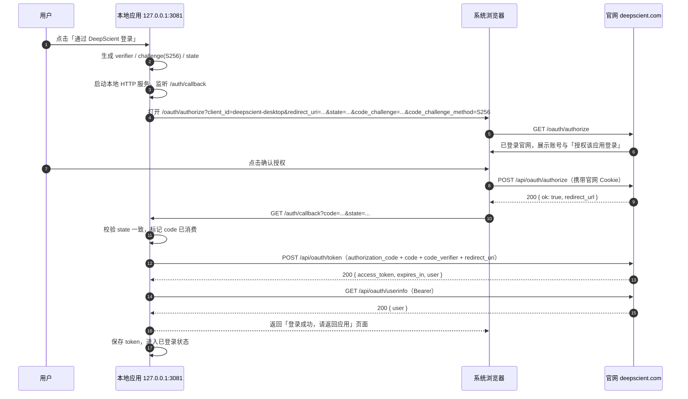
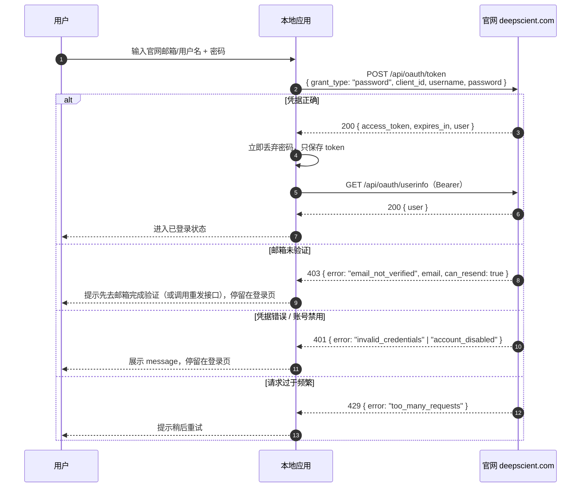

# Deepscient 统一账号中心对接文档

> 适用对象：Deepscient 桌面应用开发工程师
> 运行时要求：Node.js ≥ 22.5（示例使用内置 `fetch`、`node:crypto`）
> 文档版本：2026-10-23（注册改为强制邮箱验证）

---

## 1. 概述与架构

`https://deepscient.com` 是**唯一账号中心**：唯一用户库、唯一登录/注册权威。本地应用（默认运行在 `http://127.0.0.1:3081`，端口被占用时顺延 `3082–3099`）**不得保存用户密码**，只保存官网签发的 `access_token`。

由于应用与官网跨域、且无法共享 Cookie，登录态通过 **OAuth 2 风格授权码 + PKCE(S256) + Bearer Token** 传递：

| 场景 | 使用接口 | 说明 |
| --- | --- | --- |
| 用户已在官网登录，希望在应用内免登 | 浏览器授权页 → `POST /api/oauth/authorize` → 回调拿 `code` → `POST /api/oauth/token`（`authorization_code`） | 推荐方式，密码不经过应用 |
| 用户直接在应用登录页输入官网账号 | `POST /api/oauth/token`（`password`） | 便捷方式，密码只在本次请求中使用，**不得落盘** |

架构要点：

- 应用内所有已登录请求统一使用 `Authorization: Bearer <access_token>`。
- `access_token` 有效期 30 天（`expires_in: 2592000`），**没有 `refresh_token`**；收到 `401` 即清理本地 token 并回到登录流程。
- 官网 Cookie 会话与应用 token 相互独立：官网退出登录不会使应用 token 失效；应用退出登录应主动调用 `POST /api/oauth/revoke`。

### 1.1 固定参数

| 参数 | 值 |
| --- | --- |
| `client_id` | `deepscient-desktop` |
| `redirect_uri` | `http://127.0.0.1:<1024-65535>/auth/callback` 或 `http://localhost:<同一端口>/auth/callback`（严格匹配，禁止通配符与外域） |
| 授权码 | 一次性，5 分钟有效 |
| PKCE | 仅支持 `S256`；`code_challenge = BASE64URL(SHA256(code_verifier))`；`code_verifier` 43–128 字符 |
| Token | `Bearer`，`expires_in` = 2592000 秒，无 refresh_token |
| Base URL | `https://deepscient.com` |

### 1.2 统一数据结构

统一用户对象 `user`：

```json
{
  "id": 12,
  "username": "someone@example.com",
  "email": "someone@example.com",
  "email_verified": true,
  "role": "user",
  "balance": 100.0,
  "created_at": "2026-10-21T09:00:00+00:00",
  "disabled": false
}
```

> **强制邮箱验证（2026-10-23 起）**：注册必须以邮箱为账号，注册成功不再自动登录、不返回 `user`、不下发 Cookie；
> 用户必须点击验证邮件中的链接（`POST /api/auth/verify-email`）后才能登录。未验证账号在任何登录通道
> （官网 Cookie、OAuth `password`、OAuth 授权码）都会被拒绝，返回 `403 email_not_verified`。

统一错误体（所有非 2xx 响应）：

```json
{ "ok": false, "message": "Invalid username or password.", "error": "invalid_credentials" }
```

- `message`：可直接展示给用户的可读文案；
- `error`：机器可读错误码，程序分支请以此为准；
- 所有接口均为 JSON，响应 `Content-Type: application/json; charset=utf-8`。

### 1.3 交付物

```
deepscient-oauth/
├── README.md                  # 本文档
├── openapi.yaml               # OpenAPI 3.0.3 契约（可导入 Postman / Apifox）
└── examples/
    ├── pkce.mjs               # PKCE / state 生成
    ├── login-flow.mjs         # 完整授权码流程（本地回调服务 + 打开浏览器）
    ├── password-login.mjs     # grant_type=password 直登
    └── curl.sh                # 注册 / 登录 / userinfo / revoke 的 curl 示例
```

---

## 2. 快速开始（4 步）

### 第 1 步：确认客户端参数与发现文档

```bash
curl -sS https://deepscient.com/.well-known/deepscient-oauth
```

确认 `client_id` 为 `deepscient-desktop`，并核对 `token_endpoint`、`userinfo_endpoint` 等地址。

### 第 2 步：生成 PKCE 参数

```bash
node examples/pkce.mjs
```

输出 `verifier`、`challenge`、`state`。应用运行时应在内存中为每次登录生成一组新值，不要复用。

### 第 3 步：执行授权码登录

```bash
node examples/login-flow.mjs
# 本地联调时指向测试服务器：
node examples/login-flow.mjs --base-url http://127.0.0.1:18090
```

脚本会：探测空闲端口（3081 起）→ 启动本地回调服务 → 打开系统浏览器 → 校验 `state` → 用 `code` + `code_verifier` 换取 token → 调用 `userinfo` 打印用户 → 关闭服务。

### 第 4 步：保存 token 并用它调用接口

保存 `access_token`（OS 凭据库或加密文件），后续请求携带：

```bash
curl -sS https://deepscient.com/api/oauth/userinfo \
  -H "Authorization: Bearer $ACCESS_TOKEN"
```

返回 `401 unauthorized` 时，删除本地 token 并重新走登录流程。

---

## 3. 时序图

### 3.1 官网已登录 → 应用免登（授权码 + PKCE）



### 3.2 应用内密码登录（password grant）



---

## 4. 接口详情

通用约定：

- 请求体均为 JSON，`Content-Type: application/json`；
- 成功响应含 `"ok": true`（`revoke` 除外，仅返回 `{ "ok": true }`）；
- 失败响应为统一错误体，见各接口错误表。

### 4.1 注册 `POST /api/auth/register`

鉴权：无。

请求体：

| 字段 | 类型 | 必填 | 说明 |
| --- | --- | --- | --- |
| `email` | string | **是** | 账号即邮箱（小写化存储）；必须是可收信的邮箱 |
| `password` | string | 是 | 至少 8 位 |
| `username` | string | 否 | **已废弃**：注册以邮箱为账号，该字段被忽略 |

```json
{
  "email": "someone@example.com",
  "password": "********"
}
```

成功 `201`（**不返回 `user`，不下发 Cookie**，账号处于待验证状态）：

```json
{ "ok": true, "verification_required": true, "email": "someone@example.com", "resend_after": 60 }
```

- 服务端同时创建 `email_verified=0` 的账号并向该邮箱投递验证邮件（24 小时一次性令牌，链接形如 `https://deepscient.com/verify-email?token=...`）；
- 用户必须完成邮箱验证（见 4.10）后才能通过任何通道登录；
- 验证邮件发送失败不回滚账号，返回 `503 mail_unavailable`，可稍后调用 4.11 重发。

| HTTP | `error` | 触发条件 |
| --- | --- | --- |
| 400 | `email_required` | 未提供 `email` |
| 400 | `invalid_email` | 邮箱格式非法或长度超限 |
| 400 | `weak_password` | 密码不足 8 位 |
| 409 | `email_taken` | 邮箱已被注册（不区分是否已验证） |
| 403 | `registration_closed` | 官网关闭了注册 |
| 503 | `mail_unavailable` | 验证邮件投递失败（账号已创建，可重发） |

### 4.2 密码登录（官网 Cookie 通道）`POST /api/auth/session`

鉴权：无。该接口用于官网自身登录，成功后会 `Set-Cookie: ds_local_auth=...`；**桌面应用请勿依赖此 Cookie**，应用内登录请使用 `POST /api/oauth/token` 的 `password` 模式。

请求体：

| 字段 | 类型 | 必填 | 说明 |
| --- | --- | --- | --- |
| `username` | string | 是 | 邮箱或用户名，服务端自动识别 |
| `password` | string | 是 | 密码 |

```json
{ "username": "someone@example.com", "password": "********" }
```

成功 `200`：

```
Set-Cookie: ds_local_auth=<opaque>; ...
```

```json
{ "ok": true, "user": { "id": 12, "username": "someone@example.com", "email": "someone@example.com", "email_verified": true, "role": "user", "balance": 100.0, "created_at": "2026-10-21T09:00:00+00:00", "disabled": false } }
```

| HTTP | `error` | 触发条件 |
| --- | --- | --- |
| 401 | `invalid_credentials` | 账号或密码错误 |
| 403 | `account_disabled` | 账号已被禁用 |
| 403 | `email_not_verified` | 账号邮箱尚未验证；响应体额外含 `email` 与 `can_resend: true`，前端应引导用户查收验证邮件或调用 4.11 重发 |
| 429 | `too_many_requests` | 失败次数过多，触发限流 |

`403 email_not_verified` 响应示例：

```json
{
  "ok": false,
  "message": "Please verify your email first.",
  "error": "email_not_verified",
  "email": "someone@example.com",
  "can_resend": true
}
```

### 4.3 当前用户 `GET /api/auth/me`

鉴权：官网 Cookie **或** `Authorization: Bearer <access_token>`。

成功 `200`：

```json
{ "ok": true, "user": { "id": 12, "username": "u_ab12cd34", "email": "someone@example.com",
  "email_verified": true,
  "role": "user", "balance": 100.0, "created_at": "2026-10-21T09:00:00+00:00", "disabled": false } }
```

| HTTP | `error` | 触发条件 |
| --- | --- | --- |
| 401 | `unauthorized` | 未携带有效 Cookie / Bearer token，或 token 已过期、已撤销 |

### 4.4 登出（官网会话）`DELETE /api/auth/session`

鉴权：官网 Cookie。

成功 `200`：

```json
{ "ok": true }
```

同时清除 `ds_local_auth` Cookie。**仅影响官网会话，不影响应用侧已签发的 token**。应用内退出登录请调用 `POST /api/oauth/revoke`。

### 4.5 换取 Token `POST /api/oauth/token`

鉴权：无（授权码模式通过 PKCE 校验）。

#### A. `grant_type=authorization_code`

| 字段 | 类型 | 必填 | 说明 |
| --- | --- | --- | --- |
| `grant_type` | string | 是 | 固定 `authorization_code` |
| `client_id` | string | 是 | 固定 `deepscient-desktop` |
| `code` | string | 是 | 授权码，一次性，5 分钟内有效 |
| `redirect_uri` | string | 是 | 必须与授权时使用的值完全一致 |
| `code_verifier` | string | 是 | 43–128 字符，原始 verifier |

```json
{
  "grant_type": "authorization_code",
  "client_id": "deepscient-desktop",
  "code": "Yt3...",
  "redirect_uri": "http://127.0.0.1:3081/auth/callback",
  "code_verifier": "dBjftJeZ4CVP-mB92K27uhbUJU1p1r_wW1gFWFOEjXk..."
}
```

#### B. `grant_type=password`

| 字段 | 类型 | 必填 | 说明 |
| --- | --- | --- | --- |
| `grant_type` | string | 是 | 固定 `password` |
| `client_id` | string | 是 | 固定 `deepscient-desktop` |
| `username` | string | 是 | 邮箱或用户名 |
| `password` | string | 是 | 密码，仅在本次请求中使用 |

```json
{
  "grant_type": "password",
  "client_id": "deepscient-desktop",
  "username": "someone@example.com",
  "password": "********"
}
```

两种模式成功响应一致，`200`：

```json
{
  "ok": true,
  "token_type": "Bearer",
  "access_token": "<opaque access token>",
  "expires_in": 2592000,
  "user": { "id": 12, "username": "u_ab12cd34", "email": "someone@example.com",
  "email_verified": true,
  "role": "user", "balance": 100.0, "created_at": "2026-10-21T09:00:00+00:00", "disabled": false }
}
```

说明：

- `access_token` 可直接以 `Authorization: Bearer` 调用官网所有已鉴权 API；
- **无 `refresh_token`**，28–30 天后过期；任何接口返回 `401` 即回到登录流程；
- 授权码绑定 `client_id`、`redirect_uri` 与 `code_challenge`，且只能成功使用一次。

| HTTP | `error` | 触发条件 |
| --- | --- | --- |
| 400 | `invalid_request` | 缺少必填字段、`grant_type` 与字段组合不匹配 |
| 400 | `invalid_grant` | 授权码不存在 / 已过期 / 已被使用 / `code_verifier` 或 `redirect_uri` 不匹配 |
| 400 | `unsupported_grant_type` | `grant_type` 不是 `authorization_code` 或 `password` |
| 401 | `invalid_credentials` | `password` 模式下账号或密码错误 |
| 401 | `account_disabled` | `password` 模式下账号被禁用 |
| 403 | `client_not_allowed` | `client_id` 或 `redirect_uri` 不在白名单 |
| 403 | `email_not_verified` | `password` 模式下账号邮箱未验证（结构同上，含 `email` 与 `can_resend`） |
| 429 | `too_many_requests` | 限流（`password` 模式 5 次/分钟/IP） |

### 4.6 校验登录态 `GET /api/oauth/userinfo`

鉴权：`Authorization: Bearer <access_token>`。

```bash
curl -sS https://deepscient.com/api/oauth/userinfo \
  -H "Authorization: Bearer $ACCESS_TOKEN"
```

成功 `200`：

```json
{ "ok": true, "user": { "id": 12, "username": "u_ab12cd34", "email": "someone@example.com",
  "email_verified": true,
  "role": "user", "balance": 100.0, "created_at": "2026-10-21T09:00:00+00:00", "disabled": false } }
```

| HTTP | `error` | 触发条件 |
| --- | --- | --- |
| 401 | `unauthorized` | token 缺失 / 过期 / 已撤销 |

应用收到 401 应清除本地 token 并展示登录页。

### 4.7 撤销 Token `POST /api/oauth/revoke`

鉴权：请求体 `token` **或** `Authorization: Bearer <access_token>`（二选一）。

```json
{ "token": "<access_token>" }
```

响应恒为 `200`（幂等，未知 token 也返回成功）：

```json
{ "ok": true }
```

撤销后该 token 立即失效。

### 4.8 官网授权 `POST /api/oauth/authorize`

鉴权：**官网 Cookie**。该接口由官网授权页 `/oauth/authorize` 在用户确认授权后调用，桌面应用不直接调用它。

应用只需打开：

```
https://deepscient.com/oauth/authorize?client_id=deepscient-desktop&redirect_uri=http%3A%2F%2F127.0.0.1%3A3081%2Fauth%2Fcallback&state=<state>&code_challenge=<challenge>&code_challenge_method=S256
```

请求体：

| 字段 | 类型 | 必填 | 说明 |
| --- | --- | --- | --- |
| `client_id` | string | 是 | 固定 `deepscient-desktop` |
| `redirect_uri` | string | 是 | 必须严格匹配白名单 |
| `state` | string | 是 | 应用生成的随机串，原样回传 |
| `code_challenge` | string | 是 | `BASE64URL(SHA256(code_verifier))` |
| `code_challenge_method` | string | 是 | 固定 `S256` |

```json
{
  "client_id": "deepscient-desktop",
  "redirect_uri": "http://127.0.0.1:3081/auth/callback",
  "state": "<random state>",
  "code_challenge": "<BASE64URL(SHA256(verifier))>",
  "code_challenge_method": "S256"
}
```

成功 `200`：

```json
{ "ok": true, "redirect_url": "http://127.0.0.1:3081/auth/callback?code=...&state=..." }
```

| HTTP | `error` | 触发条件 |
| --- | --- | --- |
| 401 | `unauthorized` | 用户未登录官网（前端应弹出登录框，登录成功后重试） |
| 403 | `client_not_allowed` | `client_id` 或 `redirect_uri` 不在白名单 |
| 400 | `invalid_request` | 缺少必填字段、`code_challenge` 为空、`code_challenge_method` 非 `S256` |

补充：用户在授权页点击「取消」时不会调用本接口，官网直接跳转 `redirect_uri?error=access_denied&state=...`，应用需处理该分支。

### 4.9 客户端发现 `GET /.well-known/deepscient-oauth`

鉴权：无。

成功 `200`：

```json
{
  "issuer": "https://deepscient.com",
  "authorization_endpoint": "https://deepscient.com/oauth/authorize",
  "token_endpoint": "https://deepscient.com/api/oauth/token",
  "userinfo_endpoint": "https://deepscient.com/api/oauth/userinfo",
  "revocation_endpoint": "https://deepscient.com/api/oauth/revoke",
  "registration_endpoint": "https://deepscient.com/api/auth/register",
  "client_id": "deepscient-desktop",
  "grant_types": ["authorization_code", "password"],
  "code_challenge_methods": ["S256"],
  "redirect_uri_patterns": [
    "http://127.0.0.1:<port>/auth/callback",
    "http://localhost:<port>/auth/callback"
  ],
  "token_ttl_seconds": 2592000
}
```

建议应用启动时读取该文档获取端点，而不是把全部路径写死（`client_id` 与回调路径仍需固定）。

### 4.10 验证邮箱 `POST /api/auth/verify-email`

鉴权：无（令牌本身即凭据）。用于验证邮件落地页 `https://deepscient.com/verify-email?token=...`。

请求体：

| 字段 | 类型 | 必填 | 说明 |
| --- | --- | --- | --- |
| `token` | string | 是 | 验证邮件中的一次性令牌（24 小时有效） |

```json
{ "token": "<邮件中的令牌>" }
```

成功 `200`（**验证即登录**，同时下发官网 Cookie）：

```json
{ "ok": true, "user": { "id": 12, "username": "someone@example.com", "email": "someone@example.com", "email_verified": true, "role": "user", "balance": 100.0, "created_at": "2026-10-21T09:00:00+00:00", "disabled": false } }
```

| HTTP | `error` | 触发条件 |
| --- | --- | --- |
| 400 | `invalid_token` | 令牌不存在、已被使用或为空 |
| 410 | `token_expired` | 令牌签发超过 24 小时（此时页面应提供「重新发送验证邮件」，见 4.11） |
| 404 | `user_not_found` | 令牌对应的账号已不存在 |

> 同一令牌只能成功使用一次，二次使用返回 `400 invalid_token`。

### 4.11 重发验证邮件 `POST /api/auth/verify-email/resend`

鉴权：无。

请求体：

| 字段 | 类型 | 必填 | 说明 |
| --- | --- | --- | --- |
| `email` | string | 是 | 注册邮箱 |

```json
{ "email": "someone@example.com" }
```

响应恒为 `200`（**不暴露邮箱是否存在 / 是否已验证**）：

```json
{ "ok": true, "resend_after": 60 }
```

| HTTP | `error` | 触发条件 |
| --- | --- | --- |
| 400 | `email_required` | 未提供 `email` |
| 429 | `too_many_requests` | 限流：同一邮箱 60 秒 1 次、每小时 5 次；同一 IP 每小时 20 次 |

说明：仅当邮箱对应账号存在且未验证时才真正发信；已存在/不存在邮箱在未被限流时返回完全相同的响应，避免账号枚举。

### 4.12 错误码总表

| HTTP | `error` | 含义 |
| --- | --- | --- |
| 400 | `invalid_request` | 缺少必填字段、字段组合或格式非法 |
| 400 | `invalid_grant` | 授权码不存在 / 过期 / 已用 / verifier 或 redirect_uri 不匹配 |
| 400 | `unsupported_grant_type` | `grant_type` 非法 |
| 400 | `invalid_email` | 邮箱格式非法或超长 |
| 400 | `weak_password` | 密码不足 8 位 |
| 400 | `email_required` | 注册或重发时未提供邮箱 |
| 400 | `invalid_token` | 邮箱验证令牌不存在或已被使用 |
| 400 | `cannot_modify_self` | 管理员不能禁用自己或把自己降级为普通用户 |
| 401 | `unauthorized` | 未携带有效 Cookie / Bearer token，或 token 过期、已撤销 |
| 401 | `invalid_credentials` | 账号或密码错误 |
| 401 | `account_disabled` | 账号已被禁用（OAuth `password` 模式） |
| 403 | `account_disabled` | 账号已被禁用（官网 `/api/auth/session`） |
| 403 | `email_not_verified` | 邮箱未验证，禁止登录（含 `email`、`can_resend`） |
| 403 | `client_not_allowed` | `client_id` 或 `redirect_uri` 不在白名单 |
| 403 | `registration_closed` | 官网关闭了注册 |
| 403 | `forbidden` | 非管理员访问管理接口 |
| 404 | `user_not_found` | 目标用户不存在 |
| 409 | `email_taken` | 邮箱已被注册 |
| 410 | `token_expired` | 邮箱验证令牌超过 24 小时 |
| 429 | `too_many_requests` | 触发限流 |
| 503 | `mail_unavailable` | 验证邮件投递失败（账号已创建，可重发） |

---

## 5. 本地回调服务实现要点

参考实现：`examples/login-flow.mjs`（可直接 `node examples/login-flow.mjs` 验证）。

1. **端口探测 3081 → 3099**
   应用默认使用 `3081`；若 `EADDRINUSE`，依次尝试 `3082…3099`。每次尝试都要以“监听成功”为准，不能只做一次连接测试（存在竞态）。确定端口后再拼出 `redirect_uri = http://127.0.0.1:<port>/auth/callback`。
   - 同一端口必须同时满足 `127.0.0.1` 与 `localhost` 两种回调形式中的一种；实际使用时选一种并全程保持一致。
   - 端口